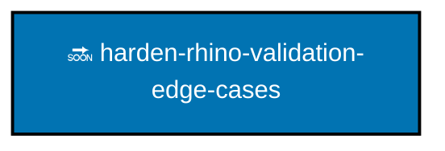

# Plans

Plans are working records, not architecture. A plan says why work exists, what it will change, and what will prove it
done. [`specs/`](../specs/README.md) says what the built binary actually does, and when the two disagree the
specification is right and the plan is history.

A plan is optional. Most work here is one delivery unit and needs no folder. A plan earns its cost when the work spans
several units or several sessions, or when the decision behind it is one a reader will want the reasoning for later. The
rule is the [plans convention](../repo-governance/conventions/plans.md) and the local additions in
[plan lifecycle](../repo-governance/conventions/plan-lifecycle.md); the procedure is
[plan execution](../repo-governance/workflows/plan/plan-execution.md).

## Stages

A plan moves through four stage folders, from a rough idea through two formal stages to a finished record.

```text
+--------+     +----------+     +--------------+     +-------+
| ideas/ | --> | backlog/ | --> | in-progress/ | --> | done/ |
| rough  |     | formal   |     | formal       |     | record|
+--------+     +----------+     +--------------+     +-------+
```

`ideas/` holds rough two-pagers. `backlog/` and `in-progress/` hold complete formal plans, queued and active. `done/`
preserves the delivery record under a completion date.

One folder moves through the stages. Move it, never copy it: two stages holding the same plan is two plans, and one of
them is lying.

## What This Repository Plans

Only work it can deliver alone. A plan whose delivery would change another repository is planned where that work is
coordinated and arrives here as its own change, with its own evidence, like any other rule that came from elsewhere —
see [rules propagation](../repo-governance/workflows/quality/rules-propagation.md). A plan that directed edits into a
sibling would be exactly the automatic propagation this repository refuses.

## Directory Map

- [Backlog](backlog/README.md) indexes complete plans that are ready but not started.
- [Done](done/README.md) preserves completed plans as dated delivery records.
- [Ideas](ideas/README.md) indexes rough two-pager briefs by urgency and importance.
- [In progress](in-progress/README.md) holds the plans being executed now.

## Plan Order

Every plan in `backlog/` and `in-progress/` appears here. Plans with no arrow between them run in parallel. An arrow
means the head starts only after the tail; a dotted arrow means the tail should land first without blocking. The graph
is updated in the same change that moves, adds, or removes a plan, per
[Plan-Order Graph](../repo-governance/conventions/plans/012-plan-order-graph.md).



Legend: 🔜 blue = backlog; 🏗️ teal = in progress. Hexagon credentialed-machine steps do not apply here. The single live
plan has no dependencies.
